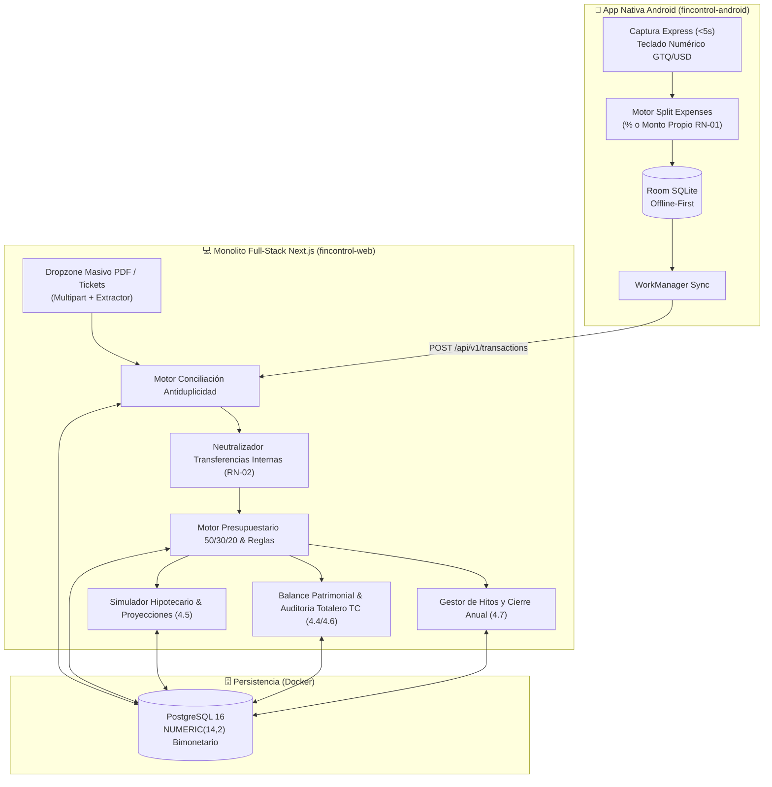

# Arquitectura del Sistema — FinControl (Web & Mobile Ecosystem)

## 1. Visión Arquitectónica

El ecosistema **FinControl** resuelve la fricción entre la captura inmediata de gastos en el punto de venta (efectivo, gastos compartidos, tickets físicos) y la auditoría contable profunda de estados de cuenta bancarios en PDF (bimonetarios `GTQ`/`USD`, tarjetas de crédito, préstamos hipotecarios y fondos de inversión).

---

## 2. Decisiones Arquitectónicas (ADRs)

### ADR-01: Monolito Unificado en Next.js (App Router) + PostgreSQL 16
- **Contexto:** Se requiere una interfaz web de alta densidad analítica y un backend seguro para sincronizar la app Android sin sobrecarga operativa de mantener múltiples servidores backend separados.
- **Decisión:** Utilizar **Next.js (TypeScript + Tailwind CSS)** como solución unificada. Las vistas de escritorio consumen datos directamente y los Route Handlers sirven tanto a la web como a la aplicación nativa Android:
  - `GET /api/v1/dashboard`: Datos consolidados (cuentas, presupuestos, transacciones, cuotas, simulador).
  - `POST /api/v1/transactions`: Registro express y sincronización móvil con cálculo split.
  - `PATCH /api/v1/transactions/[id]`: Reclasificación y auditoría manual (`RN-04`).
  - `POST /api/v1/reconcile`: Ingesta multipart/form-data de PDFs de bancos y tickets con extracción de transacciones y neutralización de transferencias propias (`RN-02`).
  - `POST /api/v1/installments`: Gestión de compras en Visa Cuotas a tasa 0% y avance de mensualidades.
  - `POST /api/v1/milestones`: Registro de hitos calendarizados (Bono 14, Aguinaldo) para proyecciones a fin de año.
- **Base de Datos:** **PostgreSQL 16** contenerizado en Docker con tipos `NUMERIC(14,2)` estrictos para evitar errores de coma flotante en cálculos bimonetarios (`GTQ` y `USD`).

### ADR-02: Tratamiento Contable de Gastos Compartidos (`RN-01`)
- **Restricción:** En toda transacción en la base de datos se cumple la invariante:
  `total_amount_gtq = personal_amount_gtq + receivable_amount_gtq`
- **Impacto:** Los semáforos de presupuesto 50/30/20 suman exclusivamente `personal_amount_gtq`. El excedente (`receivable_amount_gtq`) se contabiliza como **Activo Circulante Transitorio (Cuentas por Cobrar a Terceros)** hasta su liquidación.

### ADR-03: Motor de Conciliación Antiduplicidad y Neutralización (`RN-02`)
1. **Emparejamiento Móvil ↔ PDF Bancario:** Todo gasto registrado desde Android ingresa con estado `PENDING_STATEMENT_MATCH`. Al cargar el PDF del estado de cuenta bancario en la web, el motor busca coincidencias por `(cuenta, moneda, monto exacto, ventana de ±3 días)` y los fusiona en un único registro `RECONCILED_MERGED`, preservando la foto del ticket y notas móviles.
2. **Aislamiento de Transferencias Internas (`RN-02`):** Los pagos de tarjeta de crédito desde cuentas monetarias propias (`BANCA MOVIL` ↔ `GRACIAS POR SU PAGO`) se emparejan automáticamente por monto y ventana temporal de 72 horas, etiquetándose como `INTERNAL_TRANSFER` para no inflar ingresos ni gastos operativos.

### ADR-04: Reversibilidad Total de Asignaciones y Auditoría (`RN-04`)
- Cualquier asignación automatizada o clasificación predictiva puede ser ajustada manualmente por el usuario. Al modificarse, el registro se marca con `is_manual_override = true` impidiendo que futuras cargas automáticas de estados de cuenta sobreescriban la decisión contable del usuario.
